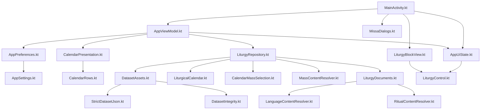
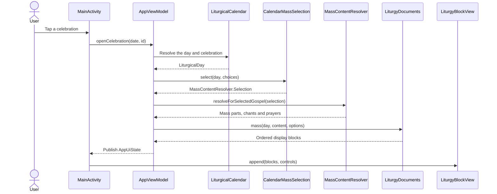

# Code structure

`sk.missa.MainActivity` is the Android entry point declared in the manifest. It builds the
native Android views, observes application state and forwards clicks, navigation and dialog choices
to `AppViewModel`. The application ID and Activity name stay stable for installed users.

Start with the [UI and feature guide](ui-guide.md) to trace a visible control to its implementation and tests.

## File diagram

Production Kotlin files under `app/src/main/java/sk/missa`:

<details>
<summary>Text file map</summary>

```text
sk/missa/
├── MainActivity.kt                         Android entry point and view wiring
├── calendar/
│   ├── EasterCalculator.kt
│   ├── LiturgicalCalendar.kt               Daily precedence and permitted celebrations
│   ├── LiturgicalDate.kt
│   ├── LiturgicalYear.kt                   Seasons and movable dates
│   └── celebration/
│       ├── Celebration.kt                  Celebration types, ranks and scopes
│       ├── CelebrationCatalog.kt           Indexed calendar definitions
│       └── DatasetCelebrationCatalog.kt    JSON records → calendar definitions
├── data/
│   ├── LiturgyRepository.kt                Shared content and calendar services
│   └── assets/
│       ├── DatasetAssets.kt                Bundled content loading and caching
│       ├── DatasetIntegrity.kt             Reference and content validation
│       ├── ValidatedDatasetCache.kt       Reuse validated records for this APK revision
│       └── StrictDatasetJson.kt            JSON decoding
├── liturgy/
│   ├── mass/
│   │   ├── CalendarMassSelection.kt        Selected day → Mass selection
│   │   ├── GospelChoiceAvailability.kt
│   │   ├── MassContentResolver.kt          Resolve parts and alternatives
│   │   ├── OrdinaryMassSelector.kt
│   │   ├── PrefaceOptionsResolver.kt
│   │   ├── SeasonalCalendarAdapter.kt
│   │   ├── SeasonalMassSelector.kt
│   │   └── SpecialMassAvailability.kt
│   └── document/
│       ├── LanguageContentResolver.kt
│       ├── LiturgyDocuments.kt             Resolved content → ordered display blocks
│       └── RitualContentResolver.kt
├── settings/
│   ├── AppPreferences.kt                  Persistent settings and Mass choices
│   └── AppSettings.kt                     Settings value
└── ui/
    ├── app/
    │   ├── AppUiState.kt                  Screen state, content entries and choice dialogs
    │   └── AppViewModel.kt                Application actions and navigation history
    ├── calendar/
    │   ├── CalendarPresentation.kt
    │   └── CalendarRows.kt
    ├── components/
    │   ├── LiturgyBlockView.kt            Native views for Masses, documents and rites
    │   ├── LiturgyControl.kt              Controls and alternatives used by those views
    │   ├── MissaStyle.kt                  Shared colors and view styling
    │   └── MissaDialogs.kt                Shared dialog appearance
    └── navigation/
        └── AppDestination.kt              Destinations and Screen enum
```

</details>

Bundled content lives in `app/src/main/assets/liturgy`. JVM tests under `app/src/test/java`
and device tests under `app/src/androidTest/java` follow the corresponding package paths.

## Main file relationships

Arrows show which file uses another; they are not inheritance relationships.

<details>
<summary>Editable Mermaid source</summary>



</details>

## Where to make a change

| Responsibility | Package and main files |
| --- | --- |
| Screen state, history and user choices | `ui.app.AppViewModel`, `AppUiState` |
| Mass text, document and popup views | `ui.components.LiturgyBlockView`, `MissaDialogs`, `LiturgyControl` |
| Calendar rows and month presentation | `ui.calendar.CalendarPresentation`, `CalendarRows` |
| Screen and bottom-menu destinations | `ui.navigation.AppDestination` (`Screen` is alongside it) |
| Saved appearance and Mass preferences | `settings.AppSettings`, `AppPreferences` |
| Date, season, precedence and transfer rules | `calendar.LiturgicalCalendar`, `LiturgicalYear`, `EasterCalculator`, `LiturgicalDate` |
| Celebration definitions and scope | `calendar.celebration.Celebration`, `CelebrationCatalog`, `DatasetCelebrationCatalog` |
| Bundled JSON loading and validation | `data.assets.DatasetAssets`, `StrictDatasetJson`, `DatasetIntegrity` |
| Shared session services | `data.LiturgyRepository` |
| Calendar-to-Mass selection | `liturgy.mass.CalendarMassSelection`, `OrdinaryMassSelector`, `SeasonalMassSelector`, `SeasonalCalendarAdapter` |
| Mass parts, variants and independent alternatives | `liturgy.mass.MassContentResolver` |
| Gospel, preface and special-Mass eligibility | `liturgy.mass.GospelChoiceAvailability`, `PrefaceOptionsResolver`, `SpecialMassAvailability` |
| Ordered Mass/document blocks | `liturgy.document.LiturgyDocuments` |
| Rites, reusable documents and language sections | `liturgy.document.RitualContentResolver`, `LanguageContentResolver` |

## How the pieces fit

1. `LiturgyRepository` loads and validates one immutable content catalog, then shares the
   calendar, selectors, resolver and document services across application screens.
2. `LiturgicalCalendar` resolves the selected date and its permitted celebrations.
   `CalendarPresentation` turns these into selectable day/month rows.
3. `CalendarMassSelection` translates the selected day and user options into a
   `MassContentResolver.Selection`. The resolver combines seasonal, formulary and proper
   content and applies the selected alternatives.
4. `LiturgyDocuments` creates ordered display blocks, expanding rites and language sections
   through the document resolvers.
5. `AppViewModel` publishes the result as `AppUiState`. `MainActivity` and
   `LiturgyBlockView` render it and send subsequent actions back to the ViewModel.

Calendar rules belong in `calendar`; content lookup and composition belong in `liturgy`.
Views consume state and blocks rather than interpreting content IDs or calculating dates.

For a normal Mass opened from a calendar row, the runtime flow is:

<details>
<summary>Editable Mermaid source</summary>



</details>

Rites and language/document entries use the document service directly rather than the
normal Mass-composition path. Dialog choices return to `AppViewModel`, which updates state
and resolves the selected content again.

## Content and preferences

The twenty files in `app/src/main/assets/liturgy` are the production content. Each has
`schemaVersion` and an `items` object keyed by opaque IDs. References such as `formularyId`,
`gospelId` and `blessingDocumentId` link records explicitly. Keep IDs stable when editing
content. `requiredOwnerFields` declares which Mass-level choices must accompany a partial
chant/prayer set; `DatasetIntegrity` checks this along with references and defaults.

`AppPreferences` retains a small, used compatibility importer for existing Missa Old
preferences. It preserves installed users' appearance settings and interprets old positional
Mass choices only for their original date and celebration. It is independent of the removed
dataset conversion tools and archives.

## Checks

Tests mirror the production packages. JVM tests cover calendar rules, selection, composition
and validation. Android tests load the actual bundled content, exercise all celebration
variants and six calendar years, and check rendering, navigation, dialogs and persistence.
Content regressions use production records directly; they need no migration archive.

From the project directory, with a suitable JDK configured:

```powershell
.\gradlew.bat :app:testDebugUnitTest :app:assembleDebug :app:lintDebug
.\gradlew.bat :app:connectedDebugAndroidTest
```

The connected checks require an emulator or Android device. The installable development APK
is written to `app/build/outputs/apk/debug/app-debug.apk`.
