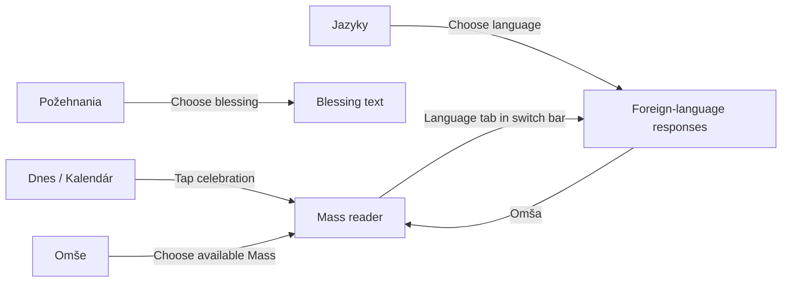

# Using and extending the Missa UI

Use the Slovak labels below to find a feature on the device. All source links point into MissaNew. The [architecture guide](code-structure.md) covers the calendar, content pipeline and build commands.

## Finding your way around

| On screen | How to use it | Where to change it |
| --- | --- | --- |
| **Dnes** | Tap a celebration under today's date to open its Mass. The row shows the celebration and liturgical color. | `calendar` in [MainActivity](../app/src/main/java/sk/missa/MainActivity.kt) draws the rows. [CalendarPresentation](../app/src/main/java/sk/missa/ui/calendar/CalendarPresentation.kt) prepares their content. |
| **Kalendár** | Use the month arrows or swipe horizontally across the calendar. Tap the celebration on the date you want. | Follow `moveMonth` and `openCelebration` in [AppViewModel](../app/src/main/java/sk/missa/ui/app/AppViewModel.kt). |
| **Omše** | Open the special Mass list and tap an entry. An unavailable Mass shows a warning for the selected day. | Follow `openEntry` in MainActivity and the eligibility rules in [SpecialMassAvailability](../app/src/main/java/sk/missa/liturgy/mass/SpecialMassAvailability.kt). |
| **Požehnania** | Follow the blessing menu to the text you want to read. Use Android Back to retrace your steps. | Start with `blessingMenuId` and `openEntry` in AppViewModel for the menu and document selection. |
| **Jazyky** | Use the language chevron to choose responses. In the reader switch bar, tap the language name for the responses or **Omša** to return to the Mass. The chevron beside **Omša** opens the Mass chooser. | Trace `readerSwitchBar` in MainActivity to `chooseLanguage`, `showLanguage` and `showMass` in AppViewModel. |
| **Mass reader** | Expand the top chevron for the available formulary, Eucharistic prayer and preface choices. Scroll for controls attached to individual parts. Double-tap plain Mass text to toggle fullscreen. | `massBar` renders the top choices. [LiturgyBlockView](../app/src/main/java/sk/missa/ui/components/LiturgyBlockView.kt) renders the text and inline controls. |
| **Otvoriť menu** | Tap the toolbar menu or swipe inward from the left edge. Use **Typ písma**, **Veľkosť**, **Nočný režim** or **Celá obrazovka** to change the display. The drawer also has switches for bells and quiet prayers. | `showDrawer` in MainActivity builds the controls. [AppPreferences](../app/src/main/java/sk/missa/settings/AppPreferences.kt) handles persistence. |

## How navigation reaches the reader

The reader serves several kinds of content. In [AppUiState](../app/src/main/java/sk/missa/ui/app/AppUiState.kt), inspect `screen` together with `resourceId` and `languageMode` when diagnosing a wrong toolbar or missing tab. In MainActivity, `render` selects the body, toolbar and navigation for that state. In AppViewModel, `back` handles a dialog or drawer before returning to previous content.

## Implementing a feature

**Add a destination.** Start with [AppDestination and Screen](../app/src/main/java/sk/missa/ui/navigation/AppDestination.kt). Follow an existing destination through AppViewModel's `destination` and MainActivity's `render`. In `bottomNavigation`, labels and icons are indexed in enum order, so update both lists in the same position. Check whether the reader drawer also needs the destination. Exercise opening it, pressing Back and recreating the activity in [AppNavigationTest](../app/src/androidTest/java/sk/missa/ui/app/AppNavigationTest.kt).

**Add a display preference.** Trace **Tučné písmo** from `showDrawer` through `applySettings`. Add the value and its default in [AppSettings](../app/src/main/java/sk/missa/settings/AppSettings.kt), then implement reading and writing in AppPreferences. Apply it wherever the affected views are built. For a typography change, check the reader, navigation and dialogs. [GlobalTextSizeTest](../app/src/androidTest/java/sk/missa/ui/app/GlobalTextSizeTest.kt) shows how to exercise multiple surfaces.

**Change a Mass text or choice.** For wording, locate the record in the [liturgy assets](../app/src/main/assets/liturgy) and follow its ID from the owning record. For a wrong alternative, start at [MassContentResolver](../app/src/main/java/sk/missa/liturgy/mass/MassContentResolver.kt). For correct text in the wrong position, inspect the ordered blocks in [LiturgyDocuments](../app/src/main/java/sk/missa/liturgy/document/LiturgyDocuments.kt). For a misplaced choice button, inspect `topControls` and `massBar` in MainActivity before editing LiturgyBlockView. The activity filters top controls by title before passing the remaining controls to the block renderer.
